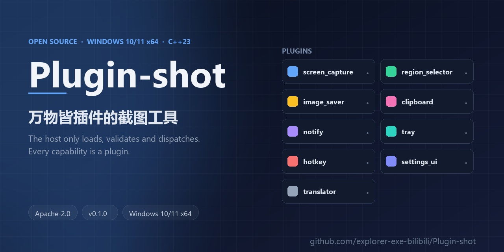
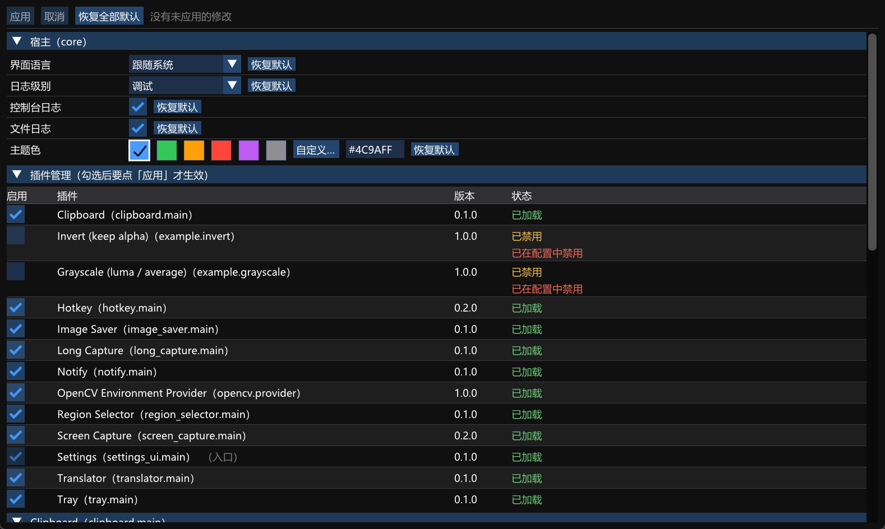

# Plugin-shot

[中文](README.md) | **English**

[](LICENSE)
[](https://github.com/explorer-exe-bilibili/Plugin-shot/releases)
[](#platforms)
[](#build)



> **A screenshot tool where everything is a plugin.** The host does only what a host
> should — load, validate, dispatch; screenshots, image processing, long capture,
> screen recording and every other capability come from plugins.

**Plugin-shot** is a Windows-first C++23 screenshot tool and an experiment in turning a
desktop utility into a plugin host: a small host, independently built and distributed
plugins, runtime hot-plug, an append-only ABI, and UI data that never enters the contract.

## At a glance

- **Download and run**: portable Windows 10/11 x64 build; unzip and start `Plugin-shot.exe`.
- **Three entry points**: `Ctrl+Alt+S` full screen, `Ctrl+Alt+A` region capture (hover a window to snap, click to capture it), `Ctrl+Alt+O` settings.
- **After the shot**: save PNG/JPEG, copy to the clipboard, show a system notification; output folder, format, quality and filename template are configurable.
- **Everything is a plugin**: tray, hotkeys, settings UI, saving, notifications and clipboard are plugins themselves, each can be disabled or re-enabled in the settings window.
- **Extend it**: build one DLL with the offline SDK to add your own processor or entry point — no host changes.

### Download

[**Plugin-shot 0.1.0 · Windows x64 portable**](https://github.com/explorer-exe-bilibili/Plugin-shot/releases/latest) ·
[Changelog](CHANGELOG.md)

Unzip and run `Plugin-shot.exe`. 0.1.0 ships a Windows build only; the Linux / macOS code
paths have not been verified on real hardware yet — see [Platforms](#platforms).

### UI



> The settings window is a plugin too: the host aggregates plugin-declared configuration
> into `config_list`, and the form, theme and plugin toggles are rendered from that data.

> **Taking over / handing to an AI agent**: read [`AGENTS.md`](AGENTS.md) first
> (build, verification, machine setup, known traps), then [`STYLE.md`](STYLE.md) (code style).

## Design

Keep the core tiny and stable, grow the product through plugins (the same idea as
DeepSeek Harness).

The **host** (currently built as `Plugin-shot.exe`) is responsible for:

- scanning the plugin directory and loading `.dll` / `.so` / `.dylib` files
- resolving exactly **one** exported symbol, `shot_module_entry`, and reading the self-describing module table
- checking `struct_size` before touching any field, then comparing `abi_major` — mismatched plugins are rejected on the spot
- asking for capabilities with `query_interface("shot.image_processor", 1)` and silently skipping the ones it does not know
- wrapping instances into C++ objects and indexing them by `PluginType`: plugins that declare no
  named capability but are present in metadata are loaded as `Generic`; plugin objects are
  destroyed by the plugin itself, the host never `delete`s them
- running the capture pipeline on a **dedicated worker thread** (bounded queue, drop + warn when
  full) so grabbing/encoding never blocks event dispatch; region captures are cropped by the host
  from the full-screen grab in physical pixels
- enabling/disabling plugins at run time: disabling is a **hot unload** (destroy instances → unsubscribe
  from the event bus → `FreeLibrary`), enabling reloads the DLL and feeds the stored configuration back
- aggregating UI data contributed by plugins into read-only JSON snapshots keyed by **list id**
  (`shot.host.plugin_lists`), with `lists.changed` as the change notification; a new data shape means a
  new list id + JSON schema, never a new ABI struct

A **plugin** (a shared library) provides the actual capability. Screenshots are the
current main line.

## Status

| Capability | State |
| --- | --- |
| Plugin loading / length and version checks / type index (incl. `PluginType::Generic` fallback) | ✅ working |
| Single entry point `shot_module_entry` + self-describing module table | ✅ working |
| Multiple plugins per DLL (`plugin_count` + `create(index)` + `get_info`) | ✅ working |
| Capability query `query_interface("shot.image_processor", 1)` | ✅ working |
| Screen capture `shot.screen_capture` (`plugins/screen_capture`, GDI over the virtual desktop in **physical pixels**; optional mouse-cursor compositing via the `include_cursor` config item, on by default; mixed-DPI dual-screen 3584x1600 verified; Wayland uses portal ScreenCast + PipeWire; Linux X11 uses `XShmGetImage` first with `XGetImage` fallback plus XFixes cursor compositing; both Linux paths compile, neither is verified on real hardware) | ✅ working (Windows; `document/CAPTURE.md`) |
| Image saving `shot.image_saver` (`plugins/image_saver`, PNG/JPEG plus four config items) | ✅ working (`document/CAPTURE.md`) |
| Capture → process → save pipeline (**worker thread + bounded queue of 4 + lifecycle lock for the whole run**; `capture.request` / `capture.done` / `capture.failed`) | ✅ working (`document/CAPTURE.md`) |
| Host main loop (event-driven **blocking wait**, no 16 ms polling; `publish` / `post_to_host` / plugin enable-disable requests wake it) | ✅ working (`document/EVENT_BUS.md` §3) |
| Region capture (`capture.request` with a valid `region`: the host grabs the full screen and crops it in physical virtual-desktop pixels, clamped; `plugins/region_selector` selection overlay with hover-to-pick-window + click-to-capture-the-window + smooth hover animation; the no-region selection-trigger request is ignored by the pipeline and never captured; full overlay on Windows and Linux X11, portal-snapshot + drag plan B on Wayland (after hiding it polls `glfwPollEvents` before encoding, and cropping/PNG encoding/disk writes run on a worker thread; the portal wait is 30 s with a progress line every 5 s; the X11 path also polls after hiding); Linux paths compile, not verified on real hardware) | ✅ working (Windows; `document/CAPTURE.md` §3.1) |
| Generic plugin type `PluginType::Generic` (only `shot.configurable` + subscriptions in `create`; loaded only when metadata declares it) | ✅ working (`document/SETTINGS.md` §3.3) |
| Host event bus `shot.host.event_bus` (topic publish / subscribe) | ✅ working (`document/EVENT_BUS.md`) |
| Generic list service `shot.host.plugin_lists` (JSON snapshot per list id: `config_list` / `tray_command_list` / `hotkey_list` / `i18n_source_list` / `i18n_list`) | ✅ working (`document/LISTS.md`) |
| List event protocol `lists.*` (`add` / `remove` / `update` / `commit` / `updated` / `changed`, event-driven writes) | ✅ working (`document/LISTS.md`) |
| Host plugin registry `shot.host.plugin_registry` (enable/disable, hot unload) | ✅ working (`document/SETTINGS.md`) |
| Runtime provider `shot.lib_provider` (`PluginType::Lib`) | ✅ working (`plugins/opencv_provider` brings OpenCV into the process) |
| UI provider `shot.ui_provider` (windows/tray/hotkeys/overlay owned by the plugin itself) | ✅ working (`plugins/settings_ui`, `plugins/tray`, `plugins/hotkey`, `plugins/region_selector`) |
| Plugin configuration `shot.configurable` (plugin declares; the host aggregates into `config_list`, event-driven writes / persistence / feed-back) | ✅ working (`document/SETTINGS.md`) |
| Settings window plugin `plugins/settings_ui` (reads `config_list`; ImGui + GLFW + OpenGL3, descriptor-driven; dual-screen 150%+100% DPI verified) | ✅ working (cross-platform; verified on Windows) |
| Tray entry `plugins/tray` (menu driven by `tray_command_list`: four core items + plugin contributions; Windows uses the Win32 tray, icon defaults to the host's named resource `IDI_ICON1` and `icon` accepts a `.ico`; Linux uses StatusNotifierItem + `com.canonical.dbusmenu` over GDBus / system `gio-2.0`, icon comes from the desktop theme, compiled but not verified on real hardware) | ✅ working (Windows) |
| Notification plugin `plugins/notify` (success/failure balloons via a hidden placeholder icon; config items `enabled` / `show_on_success` / `show_on_error` / `sound`; Linux uses libnotify, compiled but not verified on real hardware) | ✅ working (Windows) |
| Clipboard plugin `plugins/clipboard` (subscribes to `capture.done` → CF_DIB / optional CF_HDROP; config items `enabled` / `also_file_drop`; Linux uses an X11 selection, compiled but not verified on real hardware) | ✅ working (Windows) |
| Global hotkey plugin `plugins/hotkey` (**list-driven**: feature plugins add entries to the contributory `hotkey_list`, and `hotkey.main` only reads the snapshot and registers them; built-in `capture` / `region` / `settings` → `capture.request` / `settings.open`, defaults Ctrl+Alt+S / Ctrl+Alt+A / Ctrl+Alt+O; the settings window records a combo with the `options="hotkey"` control and stores it as `hotkey.main/<id>`; conflicts are first-wins in list order and later ones WARN; Windows uses `RegisterHotKey`; Linux uses X11 `XGrabKey` (lock-modifier variants, `BadAccess` conflict WARN, self-pipe event loop, suspend/resume), compiled but not verified on real hardware; pure Wayland (no X11 display) degrades at run time to exposing the list and config items without registering, pointing at `session_control` with a WARN) | ✅ working (Windows) |
| Linux session-control plugin `plugins/session_control` (exposes `org.pluginshot.Control` on the session bus; `Capture` / `CaptureRegion` / `OpenSettings` / `CaptureLong` map to existing events; Wayland has no global-hotkey API, so the desktop's custom shortcut runs `gdbus call`; config item `enabled`; Linux only) | Implemented; compiles on Linux, on-device interaction pending verification: the Linux build emits the `.so` and the host `--help` passes; the D-Bus name and methods are implemented, but the end-to-end path with a GNOME custom shortcut has not been run; see [`document/PLATFORMS.md`](document/PLATFORMS.md) §3.3 |
| Long screenshot plugin `plugins/long_capture` (manual-scroll long capture: asks `region_selector` to pick a target window, then its own GDI capture layer grabs continuous frames and stitches them online, Enter to save; config item `max_height`; Windows P1) | Shipped in 0.1.0 as an **experimental** plugin, **disabled by default in the plugin list** (`plugins.disabled`); tick it in the settings window and restart to enable the tray item and hotkey; compiles on Windows, on-device interaction pending verification: it publishes a single `capture.done` only on save; see [`document/PLATFORMS.md`](document/PLATFORMS.md) §3.3 |
| Mixed-DPI multi-monitor capture (physical virtual desktop 3584x1600; per-call thread DPI context fallback; negative origin not verified on real hardware) | ✅ working (`document/CAPTURE.md` §2.1) |
| Settings-window DPI (dual-screen 150%+100%: live rescale while dragging across monitors, geometry clamped to the target screen's DPI, non-accumulating; other DPI mixes / 3+ screens unverified) | ✅ working (`document/SETTINGS.md` §6.1) |
| Command line `--capture` (worker thread + one dispatch round before exit) / `--settings` / `--help` | ✅ working |
| GitHub Actions cross-platform CI (Linux/macOS/Windows matrix + vcpkg cache + presets + `--help` smoke) | workflow ready; the Windows job passes, while the Linux/macOS configure failures and the real per-platform status are covered by Platform below and [`document/PLATFORMS.md`](document/PLATFORMS.md) |
| Host settings (`core` pseudo-plugin: UI language / log level / console / file log / theme color) | ✅ working |
| Plugin metadata appended to the DLL tail (`metadata.json`, CMake only) | ✅ working (the host reads it before loading: prefilter + dependency topological sort) |
| Build-time metadata validation (unique ids / registered interfaces / abi matches the header / dependency syntax) | ✅ working (`cmake/ValidatePluginMeta.cmake`) |
| Plugin-level dependencies (`requires` / `provides` with version ranges, `core` = the host) | ✅ working (`document/METADATA.md`) |
| Dependency-driven load order (topological sort; an unsatisfied plugin is skipped on its own) | ✅ working |
| Shared plugin build rules (`shot_add_plugin()`) | ✅ working (host and offline SDK share one module) |
| i18n / multilingual UI (`core/language` = `auto` or a language-catalog tag; plugins contribute `i18n_source_list`, the host merges it into the read-only `i18n_list`; external packs in `files/lang/` and `%LOCALAPPDATA%\plugin-shot\langs\`; settings window and tray resolve `display(owner,key) ?? key`, literal labels from old plugins keep working) | ✅ working (`document/I18N.md`; 27 built-in tags, only zh-CN / en-US ship translations; external-pack protocol ready, translator plugin `plugins/translator` included (off by default); dynamic font atlas plus Segoe UI/Arial merge, RTL and Korean/Thai/Arabic glyphs not done) |
| Offline plugin SDK export (`export_sdk` target) | ✅ working |

> The binary name comes from `PROJECT_NAME` in `CMakeLists.txt` (currently `Plugin-shot`):
> the host is `Plugin-shot.exe` and plugins land in `bin/plugins/`. When the icon file is missing,
> the generated `.rc` simply drops its ICON line, so renaming can never break the build.

## Layout

```
.
├── CMakeLists.txt          # cross-platform build (vcpkg manifest mode; plugins auto-discovered by GLOB)
├── CMakePresets.json       # debug / release presets (also used by CI and cross-platform builds)
├── vcpkg.json              # dependency manifest
├── vcpkg-configuration.json# vcpkg builtin-baseline
├── .github/
│   └── workflows/cmake.yml # cross-platform CI (Linux/macOS/Windows)
├── files/
│   └── lang/                 # official language packs shipped with the installer (<tag>.json; synced to bin/files/ at build time)
├── include/
│   ├── plugin_api.h          # ★ umbrella header for the host ⇄ plugin ABI contract (includes only)
│   ├── plugin_api/           # ★ the contract body, one header per topic (basics / interfaces /
│   │                         # capabilities / host_services / module / abi_layout)
│   ├── plugin_api_export.h   # export macro: dllexport for plugins, SCREENSHOT_HOST_EXPORTS for the host
│   ├── shot_plugin_helpers.h # umbrella header only includes; one header per helper class
│   ├── shot_plugin_helpers/  # iface_entry / logger / config / event_bus /
│   │                         # plugin_lists / plugin_registry, one header each
│   ├── dllHandler.h           # LoadLibrary / dlopen wrapper (with a non-throwing tryGetFunction)
│   ├── pluginManager.h       # plugin scanning, dependency order, loading and hot unload (incl. Generic fallback)
│   ├── hostServices.h        # host service tables: logging, config, event bus, list service, plugin registry
│   ├── hostListCatalog.h     # generic list catalog: generates config_list + implements the lists.* protocol
│   ├── hostRuntime.h         # host wiring: PluginManager + list catalog + registry + capture pipeline + lifecycle lock
│   ├── capturePipeline.h     # capture pipeline: worker thread + bounded queue + region cropping
│   ├── config.h              # core::Config: JSON configuration file
│   └── PluginInstances/      # host-side wrappers (base / ImageProcessor / LibProvider / ScreenCapture / ImageSaver; Generic uses base)
├── src/                      # host implementation and entry point
├── plugins/                  # every subdirectory is a standalone plugin project
│   ├── example_processor/    # complete example: one DLL, two plugins, both configurable (needs OpenCV)
│   ├── opencv_provider/      # a valid package with zero capabilities (brings OpenCV into the process)
│   ├── screen_capture/       # screen capture: Windows GDI physical pixels; Linux Wayland portal + PipeWire / X11 XShmGetImage (both compiled, not verified on real hardware)
│   ├── image_saver/          # image saving: PNG/JPEG with directory/format/quality/filename config
│   ├── clipboard/            # clipboard: capture.done → CF_DIB / CF_HDROP (Windows); Linux uses an X11 selection (compiled, not verified on real hardware)
│   ├── notify/               # capture result notifications: Windows Shell balloons; Linux uses libnotify (compiled, not verified on real hardware)
│   ├── hotkey/               # list-driven global hotkey provider (RegisterHotKey on Windows; X11 XGrabKey on Linux, run-time downgrade on pure Wayland)
│   ├── session_control/      # Linux D-Bus control entry: stands in for global hotkeys on Wayland (Linux only; passes the Linux build)
│   ├── region_selector/      # selection overlay: hover-to-pick-window, click captures that window, theme-colored corner brackets (Windows; Wayland portal snapshot + drag selection; X11 GLFW overlay)
│   ├── long_capture/         # long screenshot: pick a window, then continuous frames + row-fingerprint stitching (Windows P1; compiled, interaction pending on-device verification)
│   ├── settings_ui/          # settings window: ImGui + GLFW + OpenGL3 (cross-platform, Windows verified)
│   ├── translator/           # external language packs: scans official/user dirs, contributes i18n_source_list (cross-platform code, Windows verified)
│   └── tray/                 # tray entry: data-driven menu + icon (Win32 tray + Linux SNI; Linux compiled, not verified on real hardware)
├── document/
│   ├── README_SDK.md         # SDK layout and every build constraint (written in Chinese)
│   ├── PLATFORMS.md          # cross-platform capability matrix: per-plugin status, limits, gaps and CI state
│   ├── ABI_POLICY.md         # append-only rules and the interface id registry (Chinese)
│   ├── SETTINGS.md           # settings window: config_list, event-driven writes/commit, Generic, DPI, plugin enable/disable and hot unload (Chinese)
│   ├── LISTS.md              # generic lists + event-driven design: list id registry, lists.* protocol, refresh timing (Chinese)
│   ├── CAPTURE.md            # capture pipeline: worker thread, region capture, capture.* events and --capture (Chinese)
│   ├── EVENT_BUS.md          # host event bus: topics, threading, lifetime (Chinese)
│   ├── I18N.md               # i18n protocol: language catalog, external packs, the two i18n lists, fallback chain, fonts and limits (Chinese)
│   └── METADATA.md           # metadata.json fields, authority rules, what stays out (Chinese)
├── cmake/
│   ├── ShotPlugin.cmake        # shot_add_plugin(): shared plugin build rules
│   ├── AppendPluginMeta.cmake  # appends metadata.json to the DLL tail
│   ├── prune_output_dir.cmake  # prunes output dirs (no pdb/ilk/exp/lib)
│   └── ...                     # runtime dependency layout, SDK export, pre-link kill
├── tools/
│   └── verify/                 # on-device verification: build wrapper with a build lock + capture/settings/hotkey/clipboard/i18n e2e
└── sdk/                    # offline SDK produced by export_sdk (not committed, see .gitignore)
```

## Build

Requirements: CMake ≥ 3.20 (≥ 3.21 when using `CMakePresets.json`), a C++23 compiler (MSVC on Windows), and [vcpkg](https://github.com/microsoft/vcpkg).

```bash
# toolchain lookup order: $VCPKG_ROOT, then $VCPKG_INSTALLATION_ROOT, then /opt/vcpkg
export VCPKG_ROOT=/path/to/vcpkg      # Windows: set VCPKG_ROOT=D:\vcpkg

cmake -S . -B build/Windows -DCMAKE_BUILD_TYPE=Debug
cmake --build build/Windows

# export the offline SDK so third-party plugins build without a local OpenCV install
cmake --build build/Windows --target export_sdk

# or use the CMake presets (the same path CI and cross-platform builds use; output in build/<platform>/)
cmake --preset release -DVCPKG_TARGET_TRIPLET=x64-linux   # triplet depends on the platform
cmake --build --preset release
```

On the Windows dev machine the vcvars + cmake steps are wrapped by `bash tools/verify/build.sh`
(a build lock serializes multiple terminals / agents; `--target <t>` builds a single target).
The on-device e2e scripts and their run discipline are documented in
[`tools/verify/README.md`](tools/verify/README.md).

Optional `-DSHOT_ENABLE_OPENCV=OFF` skips the plugins that depend on OpenCV
(`opencv_provider` / `example_processor`) for faster CI or OpenCV-less environments; default `ON`.

The first configure installs the manifest dependencies (`opencv4` with jpeg/png/tiff/webp
features, `nlohmann-json`, `spdlog`, `glfw3`, `nativefiledialog-extended`, `stb`, and `imgui`
— a static library with `glfw-binding` + `opengl3-binding` for the settings window), which
takes a while. Like OpenCV, the settings window's runtime DLLs (`glfw3.dll`, `nfd.dll`) are
laid out into `bin/` by `cmake/copy_runtime_deps.cmake`, not stored in the plugin directory.
The generic list protocol adds no new dependency: a list snapshot is just JSON serialized with
`nlohmann-json`. The new plugins add no new vcpkg dependency either: `clipboard` reuses `stb` /
`nlohmann-json`, `notify` only needs `user32` / `shell32`, `hotkey` only `user32`, and
`region_selector` reuses `imgui` / `glfw3` / `nlohmann-json`. `session_control` and the Linux
backend of `tray` only need the system `gio-2.0` development package (Ubuntu:
`libglib2.0-dev`, via `pkg-config`), while `long_capture` reuses `stb` / `nlohmann-json`. The
Linux X11 branch uses system X11 development packages (`libx11-dev` / `libxext-dev` /
`libxfixes-dev` / `libxrandr-dev`, see Platforms), which are not vcpkg dependencies either.
The Linux side has been compiled under WSL Ubuntu 24.04, and the full Windows build exits 0.

**CI**: `.github/workflows/cmake.yml` is ready (Linux / macOS / Windows matrix + vcpkg manifest
cache + CMake presets + headless `--help` smoke test). In the latest visible run the Windows job
passed while Linux / macOS failed at configure (vcpkg baseline — fixed but not re-run yet). See
[`document/PLATFORMS.md`](document/PLATFORMS.md) §4 for the per-platform conclusion and why a green
CI run is not platform support.

**Cross-platform status**: Linux has been verified locally under WSL2 (Ubuntu 24.04.5 LTS /
GCC 13.3.0 / x86_64 / vcpkg `x64-linux` / CMake 3.28.3 / Ninja 1.11.1 / Release): configure +
build passed (**0 warnings**), producing `build/Linux/bin/Plugin-shot` and 12 `.so` files
(13 plugin projects minus the Windows-only `long_capture`; including the Linux
implementations of `screen_capture` / `region_selector` / `session_control` /
`clipboard` / `notify` / `tray`, plus `hotkey` with its X11 branch); `--help` exits 0. **Neither the
Wayland nor the X11 path is verified on real hardware yet**: ScreenCast + PipeWire capture, the
portal-snapshot + drag-selection plan B, and X11 capture/hotkeys/selection only count once they
have run in a real desktop session; the X11 selection overlay and the X11 `screen_capture` branch
have not been integrated together yet. `SHOT_ENABLE_OPENCV=OFF` was verified too. macOS is **not
verified on real hardware** (code audit only). Windows remains the primary development and
verification platform: the full build exits 0 and all 8 e2e/smoke scripts are green (see Platforms).

**Linux artifacts must be built for the target distribution (glibc constraint)**: a `.so` links
against the build machine's glibc and system libraries, so it is not portable across
distributions. The current `build/Linux` artifacts were built under WSL Ubuntu 24.04 (glibc 2.39)
and require at most `GLIBC_2.38`, so they run on Ubuntu 24 / 26; artifacts built on Ubuntu 26
require `GLIBC_2.43` and fail to `dlopen` on Ubuntu 24. Do not share one `build/Linux` directory
across distributions, and do not copy newer artifacts back to an older distribution.

### Run

```bash
cd build/Windows/bin && ./Plugin-shot.exe            # no arguments: tray-resident
cd build/Windows/bin && ./Plugin-shot.exe --capture  # capture once, print the path, exit
cd build/Windows/bin && ./Plugin-shot.exe --settings # open settings, then stay resident (debug)
cd build/Windows/bin && ./Plugin-shot.exe --help     # print usage
```

The plugin directory is resolved as the relative path `./plugins`, so **launch from `bin/`**.

Without arguments the host does not open the settings window on its own while the tray is loaded:
the tray menu (capture / region capture / open settings / quit) publishes `capture.request`
(empty) / `capture.request` (payload `{"mode":"region"}`) / `settings.open` / `app.quit`;
"region capture" opens the `plugins/region_selector` overlay, which then publishes a request
with a `region`, and the host crops it in physical virtual-desktop pixels
(see `document/CAPTURE.md` §3.1). The selection-trigger request itself is **not captured**
(the pipeline ignores it: no grab, no file, no extra full-screen screenshot). If `tray.main`
is not loaded (disabled or failed), startup publishes `settings.open` automatically as a
fallback entry point.

Screenshots go to `%USERPROFILE%\Pictures` by default, with the `shot_%Y%m%d_%H%M%S` filename
template and PNG format; directory/format/quality/filename are `plugins/image_saver` config
items editable in the settings window. Results are shown as system notifications by
`plugins/notify` and copied to the clipboard by `plugins/clipboard` (both can be toggled in the
settings window); `plugins/hotkey` is a **list-driven hotkey provider**: by default it triggers the
same capture / region capture / open-settings actions with `Ctrl+Alt+S` / `Ctrl+Alt+A` /
`Ctrl+Alt+O`, and plugins (including itself) declare "combo → event" through the contributory
`hotkey_list` — adding a hotkey means contributing one entry instead of registering it yourself.
All hotkeys are editable in the settings window (the hotkey item is recorded by pressing a combo,
no manual typing). On X11, `hotkey` registers with `XGrabKey`; pure Wayland has no global-hotkey
API, so `hotkey` keeps exposing the list and config items but registers nothing (run-time
downgrade) and users should use the `plugins/session_control` D-Bus entry / desktop custom
shortcuts instead.

`--capture` logs `Capture saved: <path>` and exits 0 on success; it exits 1 on failure
(capture/save failure, missing plugin, full request queue) and 2 on unknown arguments. The
one-shot mode dispatches one event round before exiting, so subscribers such as the clipboard
and notification plugins also see the `capture.done` of this run (`document/CAPTURE.md` §6).
Logging goes through spdlog: console plus `%LOCALAPPDATA%\plugin-shot\logs\host.log` (appended).
Configuration lives in `%LOCALAPPDATA%\plugin-shot\config.json` (host settings and plugin items,
keyed as `<owner>/<id>`, matching the `owner` / `id` of a `config_list` entry).

### Multi-monitor and DPI

| Item | Status |
| --- | --- |
| Host DPI awareness | Declared explicitly at the earliest startup stage as **per-monitor v2** (`SetProcessDpiAwarenessContext`, falling back to `SetProcessDpiAwareness` / `SetProcessDPIAware`; failure only warns); log line `DPI awareness: <mode>` |
| Multi-monitor capture | Virtual desktop in **physical pixels**; mixed-DPI dual-screen (150% 2560x1600 + 100% 1024x768) measured as `3584x1600`; negative origin (secondary left/above) **not verified on real hardware** |
| Capture-thread DPI | `plugins/screen_capture` raises the calling thread to PMv2 for each `describe`/`capture` call and restores it afterwards; does not depend on the host process declaration |
| Settings-window DPI | Dual-screen 150%+100% verified: live rescale while dragging across monitors (non-accumulating), geometry restored and clamped to the **target** monitor's DPI (frame included); other DPI mixes (125% / 200%), 3+ screens and negative origin **unverified** |
| Region coordinates | Physical virtual-desktop pixels, origin = top-left of the virtual desktop, clamped (see `document/CAPTURE.md` §3.1) |

### Output layout (hard constraints)

| Path | Contents |
| --- | --- |
| `bin/` | host exe plus this configuration's runtime DLLs (**no `*.pdb` / `*.ilk`**) |
| `bin/plugins/` | plugin artifacts only (**no OpenCV or other base dependencies**) |
| `build/<platform>/pdb/` | every debug symbol |
| `sdk/` | offline SDK: `include/`, `lib/` (release), `lib/debug/`, `bin/`, `bin/debug/` |

These rules are enforced at build time by `cmake/copy_runtime_deps.cmake` and
`cmake/prune_output_dir.cmake`. Plugin artifacts use the platform extension
(`.dll` / `.dylib` / `.so`); on non-Windows platforms runtime libraries are not copied —
RPATH points into vcpkg's `lib/`. See contract rule 3 below: a plugin that ships its
own OpenCV puts two instances into one process.

## Plugin contract

There is exactly one entry header crossing the boundary: `include/plugin_api.h` (plain C, no STL).
It is an umbrella that only includes; the body lives in `include/plugin_api/*.h` (version and
field-reading rules, interface ids, one table per capability, host services, `ShotModule`, layout
anchors), and plugin sources still write just `#include "plugin_api.h"`. A plugin package exports **one** C function:

```c
SCREENSHOT_API const ShotModule* shot_module_entry(void);
```

It returns a self-describing module table, `ShotModule`; everything else lives inside it:

| Field | Purpose |
| --- | --- |
| `struct_size` / `abi_major` / `abi_minor` | self-described length and version: the host reads the length first, then compares the major |
| `plugin_count` | how many plugins this DLL holds |
| `get_info(index, info)` | id / name / version without creating an instance |
| `create(index, host)` | allocates the instance on the plugin's own heap and returns an opaque pointer |
| `destroy(instance)` | destroys the instance — **plugin-side only**, the host never `delete`s it |
| `query_interface(instance, id, version)` | asks "do you implement this capability?" |
| `init(host, flags)` / `shutdown()` | optional module-level setup and teardown; `nullptr` means not needed |

One DLL is one **plugin package**: `plugin_count` + `create(index)` mean the host never has to
know the contents in advance, and `plugins[]` in `metadata.json` maps index for index onto it.

### Four rules that make the ABI stop changing

1. **Add fields, never symbols.** The package exports `shot_module_entry` and nothing else. New capabilities are new fields appended to a struct, not new exports.
2. **Ask for the length before reading a field.** Every cross-boundary struct starts with `struct_size`, and readers go through `SHOT_HAS_FIELD(ptr, type, field)`. Old plugins (short structs) and new hosts (wanting new fields) coexist safely — **appending a field never needs a version bump**.
3. **Ask for capabilities by string id.** `query_interface(instance, "shot.image_processor", 1)` returns a function table or `NULL`, and the host quietly skips what it does not get. A new capability kind is a new id plus a new struct; no existing struct changes.
4. **Data shapes never enter the ABI.** A new kind of UI/host data (menu items, config items, target lists, …) is a new list id + JSON schema + `lists.*` events; the ABI describes capabilities and behaviour only, never data structures — see `document/LISTS.md`.

`include/plugin_api/abi_layout.h` (included last by the umbrella header) pins the offset and size of every struct with `static_assert`s: reordering or retyping fails the build, while appending a field forces you to update that line by hand — making an ABI break a deliberate act.

### Registered capabilities

| interface id | Struct | Purpose |
| --- | --- | --- |
| `shot.image_processor` | `ShotImageProcessorV1` | processes one image: `process(self, ShotImage*)`, 0 means success |
| `shot.screen_capture` | `ShotScreenCaptureV1` | screen capture: `describe` reports the virtual-desktop geometry (**physical pixels**, multi-monitor combined), `capture` writes BGRA8 pixels into the host-allocated `ShotImage`; region captures are cropped by the host from the full-screen grab, see `document/CAPTURE.md` |
| `shot.image_saver` | `ShotImageSaverV1` | image saving: writes a `ShotImage` to disk and returns the final path; format/quality/directory come from the plugin's config items; see `document/CAPTURE.md` |
| `shot.configurable` | `ShotConfigurableV1` | declares and reads/writes configuration items, see below |
| `shot.lib_provider` | `ShotLibProviderV1` | says "I am a runtime provider" and reports library name/version; the host registers it as `PluginType::Lib` |
| `shot.ui_provider` | `ShotUIProviderV1` | the plugin creates and owns its window/tray; the host only calls `init` / `deinit` / `post_to_plugin` |
| `shot.host.event_bus` | `ShotHostEventBusV1` | **host service**: in-process topic publish/subscribe |
| `shot.host.config` | `ShotHostConfigV1` | **host service**: host config read/write (legacy; new code uses `plugin_lists`' `config_list`) |
| `shot.host.board_msg` | `ShotHostBoardEventV1` | **host service**: legacy broadcast queue (new code uses event_bus) |
| `shot.host.plugin_lists` | `ShotHostPluginListsV1` | **host service**: generic lists, returns a read-only JSON snapshot per list id (`config_list` / `tray_command_list`), see `document/LISTS.md` |
| `shot.host.plugin_registry` | `ShotHostPluginRegistryV1` | **host service**: installed plugin states and asynchronous enable/disable |

Current contract version `SHOT_ABI_MAJOR = 2` / `SHOT_ABI_MINOR = 0`: 2.0 removed the old config
catalog service and replaced it with the generic list service `shot.host.plugin_lists` (list data is
a JSON snapshot; registration, value writes and committing all go through `lists.*` events).
Removing a published service is a breaking change, hence major 2;
**since 2.0 a new kind of UI/host data no longer changes the ABI** — a new list id + JSON schema is enough.

The capability callbacks of `shot.screen_capture` / `shot.image_processor` / `shot.image_saver`
run on the capture pipeline's **worker thread** (one image at a time, serial), while
`shot.configurable`'s `set_config` still runs on the main thread. A plugin that shares state
between capability callbacks and configuration must synchronise it itself (see
`document/CAPTURE.md` §7).

### Pure subscriber / pure configuration plugins (Generic)

A plugin does not have to implement any host-callable named capability: it can declare only
`shot.configurable`, subscribe to events in `create(index, host)`, and unsubscribe in `destroy`.
As long as `metadata.json` declares it, the host loads it as `PluginType::Generic` via the base
class wrapper: the registry lists it as LOADED, it can be enabled/disabled, and `config_list`
still enumerates its config items; a package without metadata and without any named capability
is skipped. Full rules: [`document/README_SDK.md`](document/README_SDK.md); working examples:
[`plugins/clipboard/README.md`](plugins/clipboard/README.md) and
[`plugins/notify/README.md`](plugins/notify/README.md).

`ShotImage` describes an 8-bit pixel buffer:

- `pixel_format` states the layout explicitly (`SHOT_PIXEL_FORMAT_BGRA8` today) instead of guessing from `channels`
- `stride` is in bytes and **may be negative** (bottom-up storage) or larger than `width * channels` (row padding)
- therefore always address rows explicitly; never assume `data` is contiguous

### Configuration: the plugin declares, the host renders and stores

`shot.configurable` lets a plugin list its own configuration items; the host renders a UI from
that list, stores the values and feeds them back — **the host hard-codes no key name**:

```c
typedef struct ShotConfigurableV1 {
    uint32_t struct_size;
    uint32_t version;
    uint32_t (*get_config_count)(void* self);
    int32_t  (*get_config_desc)(void* self, uint32_t index, ShotConfigDesc* out);
    int32_t  (*get_config)(void* self, const char* key, char* buf, uint32_t buf_size);
    int32_t  (*set_config)(void* self, const char* key, const char* value);
} ShotConfigurableV1;
```

- Each item is described by `ShotConfigDesc`: `kind` (BOOL / INT / FLOAT / STRING / ENUM / COLOR / PATH), `key`, label, default, range and enum options.
- **Values are always strings**: no width or alignment problem across the boundary, trivially storable as JSON, and no STL needed inside the plugin.
- A plugin must ignore unknown keys safely (return a negative value), so a newer host can send extra items to an older plugin.
- `set_config` may be called at run time (a slider drag): either be thread-safe or document "takes effect on the next `process`".

**Host settings use the same descriptors**: the host implements `shot.configurable` as a `core`
pseudo-plugin (log level, console/file log switches), and the host aggregates every configurable
instance into the `config_list` JSON snapshot, so the settings window renders one set of code.

- Storage keys are `<owner>/<id>`; the **host** persists them to
  `%LOCALAPPDATA%\plugin-shot\config.json` — plugins only get/set values and never write config files.
- On startup the host feeds stored values back into plugins (using `default_value` when nothing is
  stored yet), so a plugin never has to read configuration itself.
- Value writes go through `lists.update` (event-driven, per-item results) and persistence through
  `lists.commit`; on success the host publishes the existing `config.applied` (empty payload):
  plugins that cache derived state re-read the current values; there is **no separate reload call**.
- Output/save settings do not belong to the host: whoever implements saving declares those items
  in its own `kConfig[]`.

**Lists: a new data shape never changes the ABI.** `config_list` and the tray menu's
`tray_command_list` come from the same generic list service. To give the UI a new batch of data
(menu items, target lists, …), define a new **list id + JSON schema**, register it at run time with
`lists.add`, and let the host notify consumers with `lists.changed`; **do not add ABI structs or host
services for the data shape**. The full protocol, the list-id registry and the performance rules are
in [`document/LISTS.md`](document/LISTS.md).

The full pipeline (`config_list`, settings plugin, plugin enable/disable and hot unload) is
documented in [`document/SETTINGS.md`](document/SETTINGS.md) (Chinese).

### Settings window and plugin enable/disable

The settings window is a plugin too (`plugins/settings_ui`, implementing `shot.ui_provider`); the
host has no main window:

- it reads the `config_list` JSON snapshot through `shot.host.plugin_lists` and renders the seven
  control kinds (BOOL / INT / FLOAT / STRING / ENUM / COLOR / PATH) from the entry schema; value
  writes go through `lists.update` and persistence through `lists.commit` (tagged event round trips,
  per-item results via `lists.updated` / `config.applied`); window DPI / multi-monitor behaviour is
  described in "Multi-monitor and DPI" and `document/SETTINGS.md` §6.1;
- it manages enable/disable through `shot.host.plugin_registry`. **Disabling is a hot unload**:
  destroy the instances, send `host.shutdown` + `deinit` to UI plugins, unsubscribe from the event
  bus, and `FreeLibrary` once the last instance of the package is gone; enabling reloads the DLL and
  feeds the stored configuration back. A plugin that another loaded plugin `requires` cannot be
  disabled on its own;
- **enabling a plugin cascade-enables its dependencies**: the host first recursively enables every
  provider it `requires`; if a provider fails to enable, the whole request fails with the offending
  dependency named in `reason`;
- the tray (`plugins/tray`) can be disabled and re-enabled: its context menu is driven by
  `tray_command_list` (the host pre-seeds **four core items**: capture / region capture / open
  settings / quit; plugins contribute via `lists.add`) and clicking an item only publishes the event
  declared by that item; the icon defaults to the host exe's **named resource `IDI_ICON1`** and the
  `icon` config item can replace it with a `.ico` file. The tray **no longer shows any balloons**:
  success/failure notifications are entirely handled by `plugins/notify`; when `tray.main` is not
  loaded (disabled or failed), a resident startup publishes `settings.open` automatically so the
  settings window serves as the fallback entry point;
- other plugins use the same lifecycle and configuration chain: `plugins/notify` (capture result
  notifications), `plugins/clipboard` (system clipboard), `plugins/hotkey` (list-driven global
  hotkey provider: feature plugins contribute `hotkey_list` entries, it only registers them and
  publishes the declared events),
  `plugins/region_selector` (selection overlay publishing a `capture.request` with `region`) — they
  all cooperate only through events/configuration, never by calling other plugins directly, and the
  settings window shows their sections automatically from `config_list`;
- enable/disable requests are asynchronous: the settings window only registers them, and the host
  main thread publishes `plugins.changed` after applying them. One enable may cascade several
  dependencies, so the settings window can receive several `plugins.changed` events in a row.

### ABI rules you must follow

1. **Use the /MD runtime (`MultiThreadedDLL`)** on both sides; `/MT` gives you two CRTs.
2. **Match the host's Debug/Release configuration** — a Debug plugin only loads into a Debug host.
3. **Never bundle base dependencies** (`opencv_*.dll` etc.). One copy already sits in `bin/` next to the host exe; a second copy in the plugin directory means two OpenCV instances in one process — split type info, global state and allocators.

   > The host itself **does not link** OpenCV (`CMakeLists.txt` only links `nlohmann_json` and `spdlog`).
   > The `opencv_*.dll` files in `bin/` are placed there by `cmake/copy_runtime_deps.cmake`,
   > which copies the whole vcpkg runtime directory — they are not pulled in by linking.
   > A plugin that needs OpenCV calls `find_package(OpenCV QUIET)` in its **own**
   > `CMakeLists.txt` (see `plugins/opencv_provider`) and resolves the same DLL from `bin/` at run time.
4. **Do not pass STL containers / `std::string` / `cv::Mat` across the boundary**, and no C++ objects with virtual functions either: only POD structs and function pointers cross.
5. **Use fixed-width types only** (`uint32_t` / `int32_t` / `double`), never `int` / `long` / `size_t`; no C enums inside structs, use fixed-width constants.
6. **Never let an exception cross a DLL boundary**: catch inside every `extern "C"` function and report failure through the return value.
7. **`abi_major` must match the host.** Bump `abi_minor` for append-only additions; the host accepts plugins whose minor is ≤ its own.
8. **Structs grow at the end only**: never reorder, retype or delete; rename retired fields to `retired_xxx` and keep the slot.

### Metadata in the file tail

`cmake/AppendPluginMeta.cmake` appends `metadata.json` to the DLL **after linking**:

```text
<original binary>
---PLUGIN_META_START---
{ "schema": 1, "abi": { ... }, "plugins": [ ... ] }
---PLUGIN_META_END---
```

- Plain-text markers: no Python, no extra tool, and the host can just `rfind` them.
- Trailing data is outside the PE/ELF section table, so the loader ignores it entirely.
- The metadata travels with the file: copying or renaming a plugin can never separate a
  manifest from its DLL.
- The marker literals exist once, in `plugin_api/plugin_info.h`; at build time the script joins the
  umbrella header and every sub-header into one text (via `cmake/ReadContractHeader.cmake`) and
  reads those macros from it.
- Before appending, the metadata is validated: `plugins[]` non-empty, ids unique, every
  `interfaces` entry defined in the contract header, `abi` matching `SHOT_ABI_*`, and
  `package` matching the target name. A mistake fails the build instead of surfacing in the host.
- Field reference and authority rules: [`document/METADATA.md`](document/METADATA.md) (Chinese).
- Dependencies are **plugin-level**: `"requires": ["core>=0.1.0", "opencv>=4.12"]`, where `core`
  is the host's own version (from the CMake-generated `version.h`). The host reads every DLL's
  metadata first, topologically sorts, then loads; an unsatisfied plugin is skipped on its own
  while the rest of its package and the host keep working.

### Writing a plugin

One plugin per `.cpp`: the state, `process`, optional configuration accessors, and finally the
capability tables:

```cpp
// plugins/acme_tools/src/blur.cpp
static int32_t blur_process(void* self, ShotImage* image) {
    auto* state = static_cast<BlurState*>(state_of(self));   // note: self is the opaque instance
    // … walk the image row by row …
    return 0;                                                 // 0 means success
}

const ShotImageProcessorV1 kImageOps =
    SHOT_OPS(ShotImageProcessorV1, .process = &blur_process);

const ShotIfaceEntry kIfaces[] = {                            // capability list
    { SHOT_IFACE_IMAGE_PROCESSOR, 1, &kImageOps },
    { nullptr, 0, nullptr },                                  // terminator
};
```

`plugin_entry.cpp` does three things: register the plugins as `kEntries[]`, forward
`query_interface`, and return the module table:

```cpp
extern "C" {

SCREENSHOT_API const ShotModule* shot_module_entry(void) {
    static const ShotModule module = {
        .struct_size     = sizeof(ShotModule),
        .abi_major       = SHOT_ABI_MAJOR,
        .abi_minor       = SHOT_ABI_MINOR,
        .plugin_count    = kEntryCount,
        .get_info        = &get_info,
        .create          = &create_instance,
        .destroy         = &destroy_instance,
        .query_interface = &query_instance,   // forwards to shot_query_interface(ifaces, id, ver)
    };
    return &module;
}

}
```

The complete, buildable sample is [`plugins/example_processor/`](plugins/example_processor/README.md):
one DLL holding two plugins, both configurable, laid out as `CMakeLists.txt` + `metadata.json` +
`include/` + `src/`. SDK layout: [`document/README_SDK.md`](document/README_SDK.md); append-only
rules and the interface id registry: [`document/ABI_POLICY.md`](document/ABI_POLICY.md) (both in Chinese).

A plugin project CMakeLists does three things — find the module, list sources, point at metadata:

```cmake
list(APPEND CMAKE_MODULE_PATH "${HOST}/cmake")   # or <SDK>/cmake
include(ShotPlugin)

shot_add_plugin(acme_tools
    METADATA     metadata.json
    SOURCES      src/plugin_entry.cpp src/blur.cpp src/sharpen.cpp
    INCLUDE_DIRS include)
```

`shot_add_plugin()` owns `/MD`, `PREFIX ""`, hidden visibility, output directories, pdb
redirection, metadata appending and output pruning — rules that used to be copy-pasted into
the root `CMakeLists.txt` and drifted away from the docs.

## Platforms

> **0.1.0 release scope**: a **Windows 10/11 x64** build only. This section records the state of the
> repository code and real-hardware verification, not a promise for 0.1.0; unverified capabilities
> are not shipped in this release.

Windows is the primary development and verification platform (MSVC + vcpkg `x64-windows`). On Linux
the **default target is Wayland** (the maintainer's environment: Ubuntu 24.04 / GNOME 46 / Wayland
session), with X11 kept as the **second priority**; macOS has never built successfully. Each
plugin's `CMakeLists.txt` selects its platform implementation: `screen_capture` (Windows GDI /
Linux Wayland portal + PipeWire / Linux X11 `XShmGetImage` first with `XGetImage` fallback and
XFixes cursor compositing), `region_selector` (Windows overlay / Wayland portal snapshot + drag
selection / X11 GLFW borderless overlay + `XGetImage` snapshot), `clipboard` (Windows CF_DIB /
Linux X11 selection), `notify` (Windows Shell balloons / Linux libnotify) and `tray` (Windows
Win32 tray / Linux StatusNotifierItem + `com.canonical.dbusmenu`) all have real platform
implementations, but **the Linux side only reaches "compiles"; nothing has been verified on real
hardware**, and the X11 branch passes the WSL full build (exit 0) while the X11 selection overlay
and the X11 `screen_capture` branch have not been integrated together yet. `long_capture` (Win32
foreground window + HUD; compiled, on-device interaction pending) builds on Windows only;
`session_control` is Linux-only. **`hotkey` is the exception**: Windows compiles the
`RegisterHotKey` implementation and Linux compiles the X11 `XGrabKey` implementation; with no
`Display` (pure Wayland) it downgrades at run time to still
contributing/reading `hotkey_list` and exposing the dynamic config items but registering no global
hotkeys, warning users to use `session_control`; macOS and other platforms compile
`hotkey_window_stub.cpp`. Also cross-platform buildable: `settings_ui` (GLFW), `image_saver`,
`example_processor`, `opencv_provider`, `translator`.

**The complete capability matrix (Windows / Wayland / X11 / macOS, one status per cell, with
reasons and porting gaps) is [`document/PLATFORMS.md`](document/PLATFORMS.md); this section keeps
only build/verification conclusions — do not read it as "supported everywhere".**

| Platform | Status |
| --- | --- |
| Windows (MSVC x64) | ✅ primary development and verification platform (incl. mixed-DPI dual screen, plugin enable/disable, capture/save/notify/clipboard/hotkey/region selection); all 8 e2e/smoke scripts green this round; long capture ships but is disabled by default in the plugin list (experimental, on-device interaction pending verification) |
| Linux (WSL2 Ubuntu 24.04.5 LTS / GCC 13.3.0 / x86_64 / vcpkg `x64-linux`) | 🟡 compiles, functionality unverified: configure + build pass (0 warnings), producing `Plugin-shot` and 12 `.so` files (`screen_capture` / `region_selector` / `session_control` / `clipboard` / `notify` / `tray` (SNI) / `hotkey` (with its X11 branch) / `settings_ui` / `image_saver` / `example_processor` / `opencv_provider` / `translator`); `--help` exits 0; no real X11 / Wayland desktop run. `SHOT_ENABLE_OPENCV=OFF` also passes; see the glibc ceiling above |
| Linux (Wayland, default target) | 🟡 implemented and compiles, not verified on real hardware: ScreenCast + PipeWire capture (incl. the system permission dialog), the portal-snapshot + drag-selection plan B (polls `glfwPollEvents` after hiding, encodes on a worker thread; portal wait 30 s with a progress line every 5 s), the `session_control` D-Bus entry, the X11-selection clipboard (through XWayland), libnotify notifications and the tray (SNI + dbusmenu) all build into `.so` files; on pure Wayland `hotkey` degrades at run time (exposes the list and config items, registers nothing). No path has run in a real GNOME Wayland session yet; the tray depends on `org.kde.StatusNotifierWatcher` (the Ubuntu AppIndicators extension, shipped by default on Ubuntu GNOME; plain GNOME needs a manual install); when it is missing the plugin logs one WARN, does not crash and does not retry. See [`document/PLATFORMS.md`](document/PLATFORMS.md) §3.1 |
| Linux (X11, second priority) | 🟡 implemented and compiles, not verified on real hardware: `screen_capture` grabs the whole X screen with `XShmGetImage` first and `XGetImage` fallback plus XFixes cursor compositing; `region_selector` uses a GLFW borderless overlay + `XGetImage` background snapshot + `XQueryTree`/`_NET_WM_WINDOW_TYPE` window hit-testing (polls after hiding); `hotkey` uses `XGrabKey` (lock-modifier variants, `BadAccess` conflict WARN, self-pipe event loop, suspend/resume); the Linux clipboard/notify implementations compile too; the SNI tray backend is a session-bus protocol and applies to X11 as well (compiled, not verified on real hardware). All three exit the WSL full build with exit 0 but have not run on real hardware; the X11 selection overlay and the X11 `screen_capture` branch have not been integrated together yet. See [`document/PLATFORMS.md`](document/PLATFORMS.md) §3.2 |
| macOS | **not built and not verified on real hardware**: the CI macOS job fails at configure (vcpkg/toolchain); code audit only (`base.cpp`'s `_NSGetExecutablePath` / empty-string UB / HOME fallback); no real build or run result |
| GitHub Actions | workflow ready; the Windows job passes while Linux/macOS have configure-stage failure records (see [`document/PLATFORMS.md`](document/PLATFORMS.md) §4); a green CI run does not mean the platform is usable |

The Linux build platform uses one binary for both sessions; X11 and Wayland differ greatly at
runtime (Wayland disallows global screen capture, global hotkeys and global overlays) — see the two
columns in the matrix.

Linux host-side system dependencies (verified on Ubuntu 24.04): `build-essential ninja-build
pkg-config`, `autoconf autoconf-archive automake libtool libltdl-dev`, `bison flex gperf`,
`gettext autopoint python3-venv`, `nasm yasm`, `curl zip unzip`,
`libgl1-mesa-dev libglu1-mesa-dev libegl1-mesa-dev`, X11/wayland development libraries
(`libx11-dev libxext-dev libxfixes-dev libxrandr-dev libxinerama-dev libxcursor-dev libxi-dev
libxkbcommon-dev libwayland-dev`), `libselinux1-dev libpam0g-dev`. On Linux,
`nativefiledialog-extended` uses vcpkg's `NFD_PORTAL=ON` and does **not** need system
GTK3/dbus development packages.

Per-capability system dependencies (`session_control` and the Linux tray need
`libglib2.0-dev`; Wayland capture and selection need `libportal-dev` +
`libpipewire-0.3-dev` + `libspa-0.2-dev`; Linux notifications need `libnotify-dev`; X11 capture
needs `libx11-dev` + `libxext-dev` + `libxfixes-dev` + `libxrandr-dev`, while X11
hotkeys/selection/clipboard need `libx11-dev`), together with what is already installed, are
listed in [`document/PLATFORMS.md`](document/PLATFORMS.md) §4.1. The local WSL install has all
of these and the Linux build passes; the CI apt step also includes them (see the apt section of the
current workflow for the X11 group; the earlier round is `fc2d69e`), while the last visible run
still failed on the vcpkg baseline (fixed but not re-run).

## License

Plugin-shot is released under the [Apache License 2.0](LICENSE),
Copyright 2026 Plugin-shot contributors.

Third-party components and their licenses are listed in [NOTICE](NOTICE); the release package
also ships their full texts under `THIRD_PARTY_LICENSES/`.

## Contributing

- Build, verification, machine setup and known traps: [AGENTS.md](AGENTS.md)
- Code style and engineering conventions: [STYLE.md](STYLE.md)
- Plugin contract and design documents: [document/](document/)
- Questions and bug reports: [Issues](https://github.com/explorer-exe-bilibili/Plugin-shot/issues)
- Changelog: [CHANGELOG.md](CHANGELOG.md)
